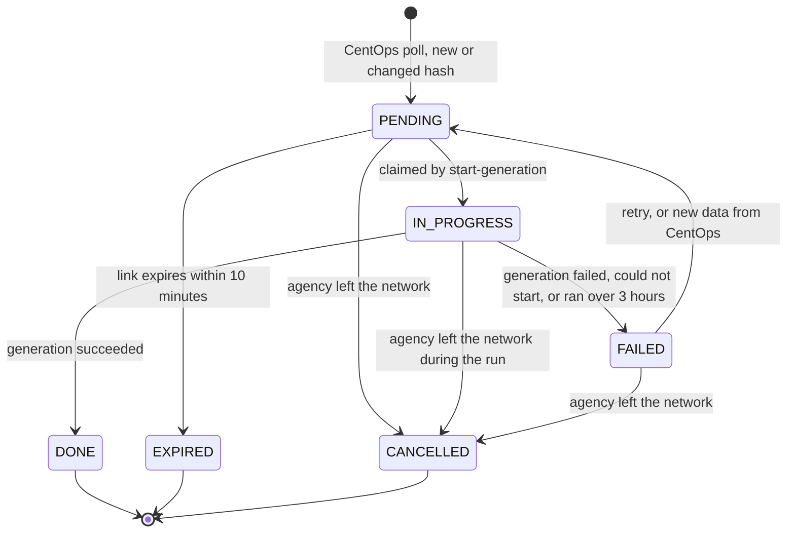
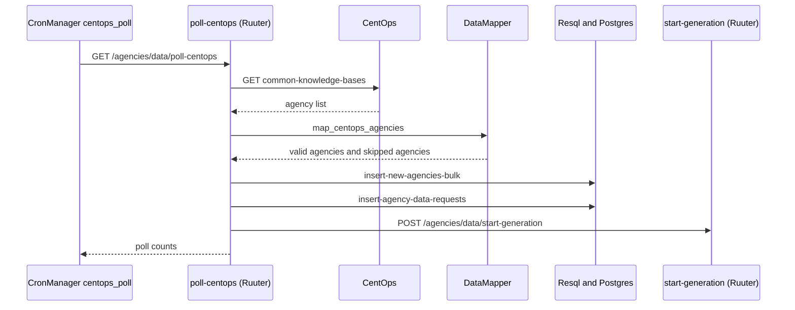
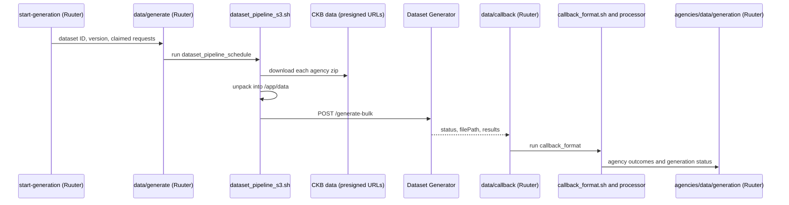

# Agency Data Sync and Dataset Pipeline

## 1. Overview

The Global Classifier (GC) trains on a synthetic dataset that is generated from each agency's Common Knowledge Base (CKB) data. GC does not call CKB itself. Once an hour it asks CentOps for the list of agency knowledge bases. For each agency, CentOps returns whether the agency is part of the network, a presigned S3 URL for its CKB data export, and a hash of that data.

GC stores new or changed data as **agency data requests**. A job that runs every five minutes collects all pending requests into one **dataset generation run**. Each run produces a new **dataset version**: the previous successful version, with the synced agencies' rows replaced by newly generated ones and the rows of agencies that left the network removed.

Key rules:

- CentOps is the source of truth for which agencies exist and which are part of the network.
- A changed data hash is what triggers a resync. Agencies whose hash has not changed are left alone.
- Only one generation run happens at a time. Requests that arrive during a run wait for the next one.
- A run that includes a new agency creates a **major** dataset version. Any other run creates a **minor** version.
- An agency that leaves the network is filtered out of classification results immediately, and removed from the next dataset version.

For the path a brand-new agency takes, see [First-Time Agency Dataset Import Flow](first-time-agency-dataset-import-flow.md).

## 2. Components

Ruuter endpoints live under `DSL/Ruuter.public/global-classifier/` or `DSL/Ruuter.private/global-classifier/`, followed by the method and path (for example `POST/agencies/data/start-generation.yml`). Resql queries live under `DSL/Resql/global-classifier/POST/`.

| Component | Where | Role |
|---|---|---|
| CronManager job `centops_poll` | `DSL/CronManager/DSL/centops_poll.yml`, `script/centops_poll.sh` | Hourly, on the hour. Calls `GET /agencies/data/poll-centops`. |
| CronManager job `agency_data_sync` | `DSL/CronManager/DSL/data_sync.yml`, `script/agency_data_sync.sh` | Every 5 minutes. Calls `POST /agencies/data/start-generation`. |
| CronManager job `dataset_pipeline_schedule` | `DSL/CronManager/DSL/dataset_pipeline_scheduler.yml`, `script/dataset_pipeline_s3.sh` | On demand. Downloads and unpacks the agency data, then calls the Dataset Generator. |
| CronManager job `callback_format` | `DSL/CronManager/DSL/callback_formatter.yml`, `script/callback_format.sh` | On demand. Runs the callback processor once the generator has finished. |
| CronManager job `dataset_remove_agencies` | `DSL/CronManager/DSL/dataset_remove_agencies.yml`, `script/dataset_remove_agencies.sh` | On demand. Creates a dataset version without the agencies that left the network. |
| `GET /agencies/data/poll-centops` | Ruuter public | Fetches the CentOps list, saves agencies and data requests, then calls `start-generation`. |
| `POST /agencies/data/start-generation` | Ruuter public | Starts at most one generation run. |
| `POST /data/generate` | Ruuter public | Triggers the `dataset_pipeline_schedule` job. |
| `POST /data/callback` | Ruuter public | Called by the Dataset Generator when a run finishes. |
| `POST /agencies/data/generation` | Ruuter public | Records the outcome of a run: completes its requests, updates agency sync status and the dataset version status. |
| `POST /agencies/data/retry` | Ruuter private | Behind the Resync button in the GUI. |
| `POST /chats/classify` | Ruuter public | Drops predictions for agencies outside the network. |
| `map_centops_agencies`, `filter_classification_to_network` | DataMapper, `DSL/DMapper/global-classifier/lib/helpers.js` | Validate and map the CentOps list. Filter classification results to the network. |
| `download_source_dataset.py` | `src/s3_dataset_processor/` | Downloads each agency's data from its presigned URL and unpacks it into `/app/data`. |
| `dataset_generation_callback_processor.py` | `src/s3_dataset_processor/` | Merges the run's output with the previous version, uploads it and reports the outcome. |
| `remove_agencies_from_dataset.py` | `src/s3_dataset_processor/` | Builds a dataset version without the given agencies. |
| Dataset Generator | External service, `GLOBAL_CLASSIFIER_DATASET_GENERATOR` | Generates synthetic data via `POST /generate-bulk`, then calls back. |
| S3 Ferry | External service, `GLOBAL_CLASSIFIER_S3_FERRY` | Moves CSV files between the CronManager file system and GC's S3 bucket. |

Each dataset version is stored in S3 as `datasets/<datasetId>/aggregated_dataset.csv`.

## 3. Data model

### 3.1 `integrated_agencies`

Columns that the sync flow reads or writes:

| Column | Meaning |
|---|---|
| `agency_id`, `agency_name` | CentOps `clientId` and `clientName`. |
| `part_of_network` | As reported by CentOps (added in v24, defaults to `TRUE`). |
| `agency_data_hash` | Hash of the data last synced successfully. An empty string means the agency has never been synced. |
| `sync_status` | See [3.3](#33-agency-sync-status). |
| `is_enabled` | Set to `TRUE` when a sync succeeds, and to `FALSE` when a sync fails or the agency leaves the network. `update-agency-enabled.sql` only lets an admin enable an agency that is part of the network and synced. |

### 3.2 `agency_data_requests`

Added in v23. Each row is one version of one agency's data that GC still has to generate from, or has already processed.

| Column | Meaning |
|---|---|
| `agency_id` | The agency. |
| `data_hash` | CentOps `presignedUrlDataHash`. |
| `presigned_url` | Download link for the agency's CKB data export. |
| `url_expires_at` | When the link expires, read from the URL's `X-Amz-Date` and `X-Amz-Expires`. If the URL has neither, CentOps `updatedAt` plus one hour. |
| `status` | `agency_request_status`: see below. |
| `dataset_version_id` | The dataset version the request was generated in. |
| `retry_count` | Number of failed attempts. |
| `error_message` | Why the request failed, expired or was cancelled. |
| `received_at`, `updated_at` | Timestamps. |

A partial unique index (`one_pending_per_agency`) allows at most one `PENDING` request per agency.

| Status | Meaning |
|---|---|
| `PENDING` | Waiting for the next run. |
| `IN_PROGRESS` | Claimed by the current run. |
| `DONE` | Generated successfully. |
| `FAILED` | The run failed. Can be retried. |
| `EXPIRED` | The link expired before a run picked the request up. The next CentOps poll inserts a new request with a fresh link. |
| `CANCELLED` | The agency left the network. |



### 3.3 Agency sync status

`integrated_agencies.sync_status` is what the Integrated Agencies page shows on each agency card.

| Value | Set when | GUI label |
|---|---|---|
| `Sync_pending_with_CKB` | A new agency arrives from CentOps as part of the network, or an agency rejoins the network. Added in v25. | Sync Pending with CKB |
| `Sync_in_progress_with_CKB` | A run claims a request for an agency that has never been synced. The GUI retry also sets it straight away, so the card updates before the run starts. | Sync in Progress with CKB |
| `Resync_in_progress_with_CKB` | A run claims a request for an agency that was synced before. | Resync in Progress with CKB |
| `Synced_with_CKB` | The agency's data was generated successfully. | Synced with CKB |
| `Sync_with_CKB_Failed` | The run failed, could not start, or ran over 3 hours. The Resync button is enabled only in this state. | Sync with CKB Failed |
| `Unavailable_in_CKB` | Only set by the manual `POST /agencies/add` endpoint. | Unavailable in CKB |
| `Resync_needed_with_CKB` | No longer set by any flow. Kept in the enum from v6. | Resync needed with CKB |

An agency that CentOps lists outside the network when GC first sees it has no sync status. An agency that leaves the network keeps its last sync status, and the GUI adds a "Not in network" label.

### 3.4 Migrations

| Changelog | Change |
|---|---|
| `global-classifier-script-v23-agency-data-requests.sql` | `agency_request_status` enum and the `agency_data_requests` table and indexes. |
| `global-classifier-script-v24-integrated-agencies-part-of-network.sql` | `integrated_agencies.part_of_network`. |
| `global-classifier-script-v25-sync-pending-with-ckb-status.sql` | `Sync_pending_with_CKB` added to `sync_status`. |
| `global-classifier-script-v26-drop-mock-centops-ckb.sql` | Drops the `mock_centops` and `mock_ckb` tables. |

## 4. Flows

### 4.1 CentOps poll (hourly)



1. **Check settings.** `CENTOPS_URL`, `CENTOPS_API_KEY` and `CENTOPS_API_SECRET` must be set in `constants.ini`, otherwise the endpoint returns 500.
2. **Call CentOps.** `GET [#CENTOPS_URL]/centops/integration/global-classifier/common-knowledge-bases`, with the `authorization` header set to the base64 encoding of `key:secret`. The reply is either a list or an object with the list in `response`.
   - 401: returns 502, "CentOps rejected GC's credentials".
   - 403: returns 502, GC's CentOps client is missing the `GLOBAL_CLASSIFIER` role.
   - Any other non-2xx status, or CentOps cannot be reached: returns 502.
3. **Validate and map** (`mapCentopsAgencies`). Every item needs `clientId`, `clientName` and a boolean `partOfNetwork`. Agencies in the network also need `presignedUrl` and `presignedUrlDataHash`. Items missing any of these are skipped and logged (`CentOps poll - skipped N agencies with missing data: [...]`), and the rest of the list is still processed. If the reply is not a list, the endpoint returns 502.

   | CentOps field | GC field |
   |---|---|
   | `clientId` | `agencyId` |
   | `clientName` | `agencyName` |
   | `partOfNetwork` | `partOfNetwork` |
   | `presignedUrl` | `presignedUrl` |
   | `presignedUrlDataHash` | `dataHash` (surrounding quotes stripped) |
   | `presignedUrl`, `updatedAt` | `urlExpiresAt` (see [3.2](#32-agency_data_requests)) |

4. **Save agencies** (`insert-new-agencies-bulk.sql`).
   - A new agency is inserted disabled and undeployed, with an empty data hash and `Sync_pending_with_CKB` if it is part of the network.
   - For an existing agency, the name and `part_of_network` are updated. See [4.4](#44-agency-leaves-the-network) and [4.5](#45-agency-rejoins-the-network) for what changes when an agency leaves or rejoins the network.
5. **Save data requests** (`insert-agency-data-requests.sql`). Only agencies in the network whose `dataHash` differs from `integrated_agencies.agency_data_hash` are considered. Each one is compared with its latest request:

   | Latest request | Action |
   |---|---|
   | `PENDING` or `FAILED` with the same hash | Refresh the link: only `presigned_url` and `url_expires_at` change. |
   | An `IN_PROGRESS` request with the same hash exists | Skip: that data is already being generated. |
   | `PENDING` or `FAILED` with a different hash | Overwrite with the new hash and link, reset to `PENDING` with `retry_count` 0. |
   | Anything else (none, `DONE`, `EXPIRED`, `CANCELLED`, or `IN_PROGRESS` with a different hash) | Insert a new `PENDING` request. |

6. **Start generation.** Calls `start-generation`. If that call fails, the poll still succeeds: the 5-minute job picks the requests up.
7. **Report.** Logs and returns `received`, `accepted` (requests inserted or overwritten), `invalid` (skipped), `unchanged` and `newAgencies`.

### 4.2 Starting a generation run

`POST /agencies/data/start-generation` is called every 5 minutes by `agency_data_sync`, after every CentOps poll, and by the GUI retry.

1. **Clear stuck runs** (`update-stuck-generation-failed.sql`). A dataset version still `Generation_in_Progress` 3 hours after it was created is set to `Generation_Failed`. Its `IN_PROGRESS` requests, and any other `IN_PROGRESS` request not updated for 3 hours, become `FAILED` ("Generation timed out", `retry_count` + 1), and their agencies become `Sync_with_CKB_Failed`.
2. **One run at a time** (`check-generation-in-progress.sql`). If any dataset version is `Generation_in_Progress` or any request is `IN_PROGRESS`, it returns `{ started: false, reason: "generation already running" }`.
3. **Retry failed requests** (`update-retryable-agency-data-requests.sql`). An agency's latest request goes from `FAILED` back to `PENDING` if `retry_count` is below 3 and its link is valid for more than 10 more minutes.
4. **Expire requests** (`update-expired-agency-data-requests.sql`). `PENDING` requests whose link expires within 10 minutes become `EXPIRED`.
5. **Claim requests** (`update-claimed-agency-data-requests.sql`). Every `PENDING` request of an agency in the network becomes `IN_PROGRESS`.
6. **Nothing claimed.** It checks whether agencies need removing from the dataset (see [4.4](#44-agency-leaves-the-network)). If none do, it returns `{ started: false, reason: "nothing pending" }`.
7. **Create the dataset version.** If any claimed agency has never been synced (empty data hash), it calls `POST /datasets/version/major`, otherwise `POST /datasets/version/minor`. Both insert a `dataset_versions` row with `Generation_in_Progress`.
8. **Link requests** (`update-requests-dataset-version-and-agencies-sync-status.sql`). Sets each request's `dataset_version_id` and each agency's status to `Sync_in_progress_with_CKB` or `Resync_in_progress_with_CKB`.
9. **Trigger the pipeline.** Calls `POST /data/generate` with the dataset ID, version numbers and claimed requests. That endpoint URL-encodes the request list and runs the `dataset_pipeline_schedule` CronManager job.
10. Returns `{ started: true, datasetId, agencies }`.

If creating the version, linking the requests or calling `/data/generate` fails, the version is set to `Generation_Failed`, the claimed requests become `FAILED` and their agencies `Sync_with_CKB_Failed`. The endpoint returns 500, and the requests are retried on a later run.

### 4.3 Generation, callback and the new dataset version



**Pipeline script** (`dataset_pipeline_s3.sh`)

1. Creates a progress session (`POST /datasets/progress/create`). The session moves through Downloading Source Datasets (10%), Calling Dataset Generation (40%) and Dataset Generation In progress (60%). The callback then sets New Dataset Uploading to s3 (85%) and Success (100%).
2. Runs `download_source_dataset.py` to download each agency's zip and unpack it into `/app/data`.
3. Sends one entry per unpacked agency to `[#GLOBAL_CLASSIFIER_DATASET_GENERATOR]/generate-bulk`. Each entry holds `agency_id`, `agency_name`, `data_path`, `output_filename`, `version_id` and `session_id`. The output file name and version ID are both the dataset ID.
4. If the download fails, nothing could be unpacked, or the generator rejects the request, the script marks the progress session failed and posts `Generation_Failed` to `/agencies/data/generation`, listing the affected agencies as `Sync_with_CKB_Failed`. It then clears this run's files from `/app/data`.

**Callback** (`POST /data/callback`)

- `success`: runs the `callback_format` CronManager job with `taskId` (the progress session ID), `filePath` and `results`.
- `failed` or `error`: reads the dataset ID from the file name (`<datasetId>.csv`). If there is no file path, it uses the dataset version that is currently in progress. It then posts `Generation_Failed` to `/agencies/data/generation`. If recording the failure fails, it returns 500 so that the generator retries the callback.

**Callback processor** (`dataset_generation_callback_processor.py`)

1. Gets the agencies in the network. If this call fails, the run fails, so that no version keeps an agency that left.
2. Finds the latest `Generation_Success` version before this one. It does not use `datasetId - 1`, which may have failed.
3. Downloads that version's CSV from S3 and builds the new one:
   - removes the rows of agencies generated in this run, since their new rows replace them
   - appends this run's rows
   - removes the rows of agencies outside the network
   - renumbers `item_id` as `<datasetId>_<n>` and sets `dataset_version_id`

   If there is no previous version or its CSV cannot be downloaded, only this run's rows are used.
4. Calls `POST /datasets/update` to load the CSV into the `datasets` table.
5. Uploads the CSV to `datasets/<datasetId>/aggregated_dataset.csv`.
6. Posts the outcome to `/agencies/data/generation`: each agency is `Synced_with_CKB` or `Sync_with_CKB_Failed` according to the generator's results, and the version is `Generation_Success` only if every agency succeeded.
7. Clears `/app/data` and `/app/output_datasets`, and sets the progress session to Success.

If the processor fails, `callback_format.sh` posts `Generation_Failed` for the dataset and marks the progress session failed.

**Recording the outcome** (`POST /agencies/data/generation`)

This endpoint runs `update-completed-agency-data-requests.sql`, then `update-data-generation-status.sql` to set the version's `generation_status`. For each `IN_PROGRESS` request in the version:

| Condition | Request | Agency |
|---|---|---|
| The agency has left the network | `CANCELLED` | Unchanged |
| The run succeeded and the agency is `Synced_with_CKB` | `DONE` | `agency_data_hash` set to the request's hash, `Synced_with_CKB`, enabled |
| Anything else | `FAILED`, `retry_count` + 1 | `Sync_with_CKB_Failed`, disabled |

When the generation status is `Generation_Failed`, every request in the version fails, including agencies that the generator reported as successful. A failed resync also disables an agency that was enabled before. Its rows stay in the last successful dataset version.

### 4.4 Agency leaves the network

When CentOps reports `partOfNetwork: false` for an agency that was in the network:

1. **Poll.** The agency's `part_of_network` and `is_enabled` are set to `FALSE`, and its `PENDING` and `FAILED` requests become `CANCELLED` ("Agency left the network"). The GUI shows a "Not in network" label, and the agency cannot be enabled.
2. **Classification.** `POST /chats/classify` fetches the agencies in the network (`get-agencies-in-network.sql`), and `filterClassificationToNetwork` drops predictions for every other agency. If no prediction remains, it returns only `out_of_distribution` with confidence 1. This takes effect immediately, even though the deployed model still knows the agency.
3. **Dataset.** Any regular run drops the agency's rows while merging (see [4.3](#43-generation-callback-and-the-new-dataset-version)). If nothing is pending, `start-generation` creates a removal version instead:
   1. `get-agencies-to-remove-from-dataset.sql` finds agencies outside the network that still have rows in the latest successful version.
   2. It creates a minor version and runs the `dataset_remove_agencies` CronManager job with the new and previous dataset IDs and the agency IDs.
   3. `remove_agencies_from_dataset.py` copies the previous version's CSV without those agencies' rows, loads it via `/datasets/update`, uploads it, and sets the version to `Generation_Success`.
   4. If any step fails, the version is set to `Generation_Failed`, and the next `start-generation` call tries again.

### 4.5 Agency rejoins the network

When CentOps reports `partOfNetwork: true` for an agency marked outside the network, the poll sets `part_of_network` to `TRUE` and `sync_status` to `Sync_pending_with_CKB`. It also clears `agency_data_hash`, because the agency's rows were removed from the dataset.

With an empty hash, the CentOps hash always differs, so a new request is saved, and the agency counts as new: its run creates a major version. The agency stays disabled until that sync succeeds.

### 4.6 Manual retry from the GUI

On the Integrated Agencies page, the Resync button is enabled only when the agency is `Sync_with_CKB_Failed`. It calls `POST /agencies/data/retry` on Ruuter private with `{ agencyId }`.

1. `update-failed-agency-data-request-pending.sql` resets the agency's latest request to `PENDING` if it is `FAILED`, the agency is in the network and the link is valid for more than 10 more minutes. Unlike the automatic retry, it ignores `retry_count`. It sets the agency to `Sync_in_progress_with_CKB`.
2. It calls `start-generation`. If a run is already going, the request stays `PENDING` and the next run picks it up.
3. It returns `{ retried: true, generation }`, or `{ retried: false, reason: "not retryable" }`. In the second case, the GUI says the link may have expired and a new one will arrive with the next CentOps poll.

## 5. Failure handling

| What fails | What happens | How it recovers |
|---|---|---|
| CentOps settings missing | Poll returns 500. | Set the `CENTOPS_*` values in `constants.ini`. |
| CentOps unreachable, 401, 403, other error, or not a list | Poll returns 502. Nothing is saved. | The next hourly poll. |
| An agency entry is missing fields | That agency is skipped and logged. | The next poll, once CentOps has the data. |
| A link expires before a run picks it up | Request becomes `EXPIRED`. | The next poll inserts a new request with a fresh link. |
| The run cannot start | Version `Generation_Failed`, requests `FAILED`. | Automatic retry. |
| Download, unpack or the generator call fails | Version `Generation_Failed`, agencies `Sync_with_CKB_Failed`. | Automatic retry. |
| The generator reports a failure | The callback sets `Generation_Failed`. | Automatic retry. |
| Callback processing fails | `callback_format.sh` sets `Generation_Failed`. | Automatic retry. |
| No callback within 3 hours | The stuck clean-up sets `Generation_Failed` and fails the requests. | Automatic retry. |
| A request has failed 3 times | Automatic retries stop. | New data from CentOps (resets `retry_count`), or Resync in the GUI while the link is valid. |
| A removal version fails | Version `Generation_Failed`. | The next `start-generation` call. |

## 6. Configuration

`constants.ini`:

```ini
GLOBAL_CLASSIFIER_DATASET_GENERATOR=http://dataset-gen-service:8000
CENTOPS_URL=
CENTOPS_API_KEY=
CENTOPS_API_SECRET=
```

- `CENTOPS_URL` is the CentOps base URL. GC appends `/centops/integration/global-classifier/common-knowledge-bases`.
- `CENTOPS_API_KEY` and `CENTOPS_API_SECRET` are GC's CentOps client credentials. The client needs the `GLOBAL_CLASSIFIER` role.
- `constants.ini` is mounted into the CronManager container at `/app/constants.ini`. Shell scripts load it with `source /app/scripts/load_constants.sh`, and `src/s3_dataset_processor/constants.py` reads it with `configparser`. The `CONSTANTS_FILE` environment variable overrides the path, which the tests use.
- Job schedules are in `DSL/CronManager/DSL/*.yml`, as Quartz cron expressions that start with a seconds field.
- The timing rules are in the Resql queries:
  - the 3-hour stuck limit is in `update-stuck-generation-failed.sql`
  - the 10-minute link margin is in `update-expired-agency-data-requests.sql`, `update-retryable-agency-data-requests.sql` and `update-failed-agency-data-request-pending.sql`
  - the 3 automatic attempts are in `update-retryable-agency-data-requests.sql`

## 7. Logging and secrets

- Request and response content logging is off for Ruuter public in `docker-compose.yml` and `docker-compose-dev.yml` (`application.logging.displayRequestContent=false`, `displayResponseContent=false`), so the presigned URLs and the CentOps authorization header that pass through the public sync endpoints are not written to the logs. Ruuter private still logs request and response content.
- The CentOps credentials are base64-encoded inside the `poll-centops` DSL instead of through DataMapper, because DataMapper would log the secret as the request body.
- `centops_poll.sh` logs only the poll counts or the error message.
- Agencies skipped for missing data appear only in the Ruuter log line `CentOps poll - skipped ...`. There is no GUI view for them yet.

## 8. Removed in this rework

The flows that pulled agency data from CKB and the mocks that stood in for CentOps and CKB are gone:

- **Tables:** `mock_centops` and `mock_ckb` (dropped in v26).
- **Ruuter private:** `POST /agencies/data/sync`, `/agencies/data/resync`, `/agencies/data/update`, `/agencies/fetch`, `/centops/new-agencies`, `/ckb/agency-data-exist`, `/ckb/agency-data-import`.
- **Ruuter public:** `POST /agencies/data/sync`, `/agencies/data/resync`, `/agencies/data/update`, `/centops/new-agencies`, `/ckb/agency-data-exist`, `/ckb/agency-data-import`, `/ckb/agency-data-url`.
- **Resql:** `check-agency-data-availability`, `insert-agency-presigned-url`, `update-agency-presigned-url`, `update-agency-data`, `mock-get-agencies-from-centops`, `mock-get-data-from-ckb`.
- **CronManager:** the `data_resync` job (`agency_data_resync.sh`) and the `mock_signed_url_generation` job (`presigned_url_generate.sh`). The `agency_data_sync` job now calls `start-generation`.
- **Python:** `src/scripts/generate_signed_urls.py`.

## 9. Tests

- Unit tests for the callback processor and the removal script are in `src/tests/s3_dataset_processor/`.
- Integration tests that run `dataset_pipeline_s3.sh` end to end against real Ruuter, Resql, Postgres and CronManager containers are in `tests/integration_tests/`. See [its README](../../tests/integration_tests/README.md).
