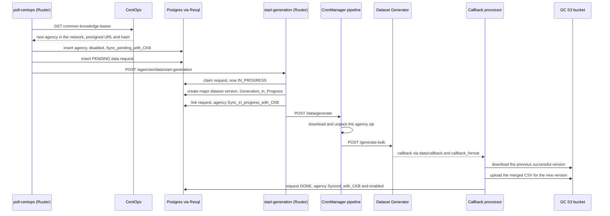

# First-Time Agency Dataset Import Flow

## 1. Overview

This document follows a single agency from the moment CentOps first lists it to the point where its data is part of a dataset version and the agency is enabled. The same path applies to an agency that rejoins the network, because rejoining clears its data hash.

Retries, agencies leaving the network, the data model and configuration are covered in [Agency Data Sync and Dataset Pipeline](data-pipeline-architecture.md).

## 2. End-to-end sequence

## 3. Steps

### 3.1 CentOps lists the agency

1. The hourly `centops_poll` job calls `GET /agencies/data/poll-centops`. The CentOps entry for the agency has `clientId`, `clientName`, `partOfNetwork: true`, `presignedUrl` and `presignedUrlDataHash`.
2. `insert-new-agencies-bulk.sql` inserts the agency:

   | Column | Value |
   |---|---|
   | `is_enabled` | `FALSE` |
   | `enable_allowed` | `FALSE` |
   | `deployment_status` | `undeployed` |
   | `agency_data_hash` | `''` (never synced) |
   | `sync_status` | `Sync_pending_with_CKB` |
   | `part_of_network` | `TRUE` |

   The agency card on the Integrated Agencies page shows "Sync Pending with CKB".
3. `insert-agency-data-requests.sql` sees that the CentOps hash differs from the empty stored hash and inserts a `PENDING` request with the link and its expiry time.
4. The poll calls `start-generation` straight away, so a new agency does not have to wait for the 5-minute `agency_data_sync` job.

If CentOps lists the agency with `partOfNetwork: false` the first time GC sees it, the agency is saved with no sync status and no data request. Nothing is generated until CentOps reports it as part of the network.

### 3.2 A run claims the request

1. If another run is already in progress, the request stays `PENDING` and the 5-minute job tries again.
2. If the link will expire within 10 minutes before a run claims the request, the request becomes `EXPIRED`, and the next CentOps poll inserts a new one with a fresh link.
3. When a run starts, every `PENDING` request is claimed together, so the new agency may share a run with resyncs of other agencies.
4. Because the agency's stored hash is empty, `start-generation` creates a **major** dataset version, for example 2.0 after 1.3.
5. The request is linked to the version and the agency becomes `Sync_in_progress_with_CKB` ("Sync in Progress with CKB" in the GUI).

### 3.3 The data is downloaded and generated

1. `POST /data/generate` runs the `dataset_pipeline_schedule` CronManager job (`dataset_pipeline_s3.sh`).
2. The script creates a progress session for the version, then runs `download_source_dataset.py`, which downloads the agency's zip from its presigned URL and unpacks it into `/app/data`.
3. It calls the Dataset Generator's `POST /generate-bulk` with the agency's ID, name and data path, and the dataset ID as the output file name.

### 3.4 The new dataset version is built

When the generator finishes, it calls `POST /data/callback`. That endpoint runs the `callback_format` CronManager job, which runs `dataset_generation_callback_processor.py`:

1. Downloads the CSV of the latest successful dataset version from S3, and adds this run's rows to it. For the very first dataset, only this run's rows are used.
2. Drops the rows of agencies outside the network and renumbers the rows for the new version.
3. Loads the CSV into the `datasets` table (`POST /datasets/update`) and uploads it to `datasets/<datasetId>/aggregated_dataset.csv`.
4. Reports the outcome to `POST /agencies/data/generation`.

### 3.5 The outcome is recorded

| Outcome | Request | Agency | Dataset version |
|---|---|---|---|
| Success | `DONE` | `agency_data_hash` set, `Synced_with_CKB`, enabled | `Generation_Success` |
| Failure | `FAILED`, `retry_count` + 1 | `Sync_with_CKB_Failed`, disabled | `Generation_Failed` |

On failure the stored hash stays empty, so the retry also counts as a new agency and creates another major version. A run that never calls back is failed by the stuck clean-up after 3 hours. Failed requests are retried automatically up to 3 attempts while the link is valid. After that they wait for new data from CentOps or a Resync from the GUI. See [Failure handling](data-pipeline-architecture.md#5-failure-handling).

## 4. After the import

- The agency is enabled, but classification can only predict it once a model trained on this dataset version, or a later one, is deployed.
- When CentOps later reports a different data hash for the agency, the same flow runs as a resync: the agency becomes `Resync_in_progress_with_CKB`, and the run creates a minor version unless it also includes a new agency.

## 5. Endpoints and queries involved

| Step | Endpoint or query |
|---|---|
| Poll | `GET /agencies/data/poll-centops`, DataMapper `map_centops_agencies` |
| Save agency | `insert-new-agencies-bulk.sql` |
| Save request | `insert-agency-data-requests.sql` |
| Start run | `POST /agencies/data/start-generation`, `update-claimed-agency-data-requests.sql`, `POST /datasets/version/major` |
| Link request | `update-requests-dataset-version-and-agencies-sync-status.sql` |
| Generate | `POST /data/generate`, `dataset_pipeline_s3.sh`, Dataset Generator `POST /generate-bulk` |
| Callback | `POST /data/callback`, `callback_format.sh`, `dataset_generation_callback_processor.py` |
| Record outcome | `POST /agencies/data/generation`, `update-completed-agency-data-requests.sql`, `update-data-generation-status.sql` |
| Progress | `POST /datasets/progress/create`, `POST /datasets/progress/update` |
