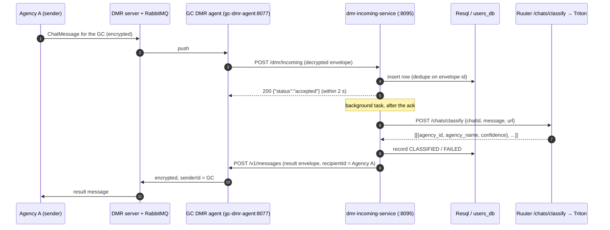
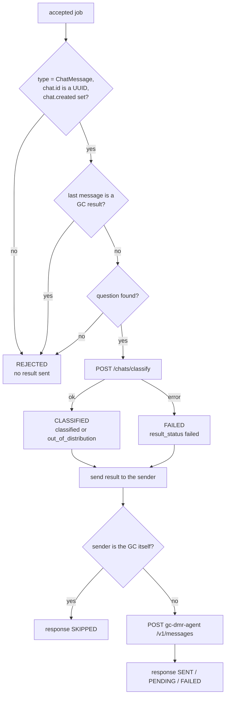

# dmr-incoming-service

The Global Classifier's (GC's) entry point for **DMR** (the Bürokratt message relay between agencies).

Another agency's chatbot sends a chat over DMR to the GC. The GC classifies the end user's question and sends **one result message** back to that agency, naming the agency the question belongs to.

- The GC answers **the sender only**. Nothing goes to the classified agency.
- **No message content is stored or logged.** The database row holds IDs, statuses and the classification.

To set it up in staging, see [STAGING_SETUP.md](STAGING_SETUP.md).

---

## Contents

1. [Where it sits](#1-where-it-sits)
2. [Endpoints](#2-endpoints)
3. [Incoming payload (DMR → GC)](#3-incoming-payload-dmr--gc)
4. [Ack response](#4-ack-response)
5. [Processing after the ack](#5-processing-after-the-ack)
6. [Classify call (GC → /chats/classify)](#6-classify-call-gc--chatsclassify)
7. [Outgoing payload (GC → its DMR agent)](#7-outgoing-payload-gc--its-dmr-agent)
8. [Retries and the sweeper](#8-retries-and-the-sweeper)
9. [Database table](#9-database-table)
10. [Configuration](#10-configuration)
11. [Security](#11-security)
12. [Files and tests](#12-files-and-tests)

---

## 1. Where it sits



The DMR agent decrypts the message and POSTs it to the URL in its `OUTGOING_MESSAGE_ENDPOINT`. Set that to `http://dmr-incoming-service:8095/dmr/incoming`. To send, the GC POSTs to the same agent's `/v1/messages`. The agent sets `senderId` to the GC, encrypts the message and hands it to the DMR server.

**Why ack first:** DMR waits at most **2 s** (`MESSAGE_DELIVERY_TIMEOUT_MS`) for a 2xx. Without one, it redelivers the same envelope. Classifying takes longer than that, so the service acks after a single database insert and does the rest in a background task.

---

## 2. Endpoints

| Method and path | Purpose |
|---|---|
| `POST /dmr/incoming` | Receives a message from the GC's DMR agent. Acks right away, then classifies and answers in the background. |
| `GET /dmr/messages/{message_id}` | The database row for one message, without content. For tests and debugging only. `404` if it doesn't exist, `503` if Resql fails. |
| `GET /health` | `{"status":"healthy","service":"dmr-incoming-service"}`. The Docker healthcheck uses it. |

The service runs on port **8095** with **one** uvicorn worker. The sweeper and the in-flight tracking live in the process, so it must not run more than one worker.

---

## 3. Incoming payload (DMR → GC)

`POST /dmr/incoming` receives the decrypted DMR envelope:

```json
{
  "id": "b1a7e8c2-1234-4f56-9abc-1234567890ab",
  "senderId": "a1e45678-12bc-4ef0-9876-def123456789",
  "recipientId": "d3b07384-d9a0-4c3f-a4e2-123456789abc",
  "timestamp": "2026-11-06T10:30:00.000Z",
  "type": "ChatMessage",
  "payload": {
    "chat": {
      "id": "f47ac10b-58cc-4372-a567-0e02b2c3d479",
      "created": "2026-11-06T10:00:00.000Z",
      "endUserUrl": "https://www.eesti.ee"
    },
    "messages": [
      {
        "id": "550e8400-e29b-41d4-a716-446655440000",
        "chatId": "f47ac10b-58cc-4372-a567-0e02b2c3d479",
        "content": "Tere! Kuidas saan teid aidata?",
        "authorTimestamp": "2026-11-06T10:29:00.000Z",
        "authorRole": "buerokratt"
      },
      {
        "id": "6ba7b810-9dad-41d1-80b4-00c04fd430c8",
        "chatId": "f47ac10b-58cc-4372-a567-0e02b2c3d479",
        "content": "Kuidas ma saan taotleda uut passi?",
        "authorTimestamp": "2026-11-06T10:30:00.000Z",
        "authorRole": "end-user"
      }
    ]
  }
}
```

### How each field is used

| Field | Required | What the GC does with it |
|---|---|---|
| `id` | Yes, a UUID | Dedupe key (`message_id`). If it's missing or not a UUID, the message is **ignored**. |
| `senderId` | Yes, a UUID | The agency that sent it. The result goes back to it as `recipientId`. If it's missing or not a UUID, the message is **ignored**. |
| `recipientId` | No | Stored only (it should be the GC's agent ID). |
| `timestamp` | No | Stored as `sent_at` if it's ISO 8601. Otherwise it's stored as null. |
| `type` | Yes, `ChatMessage` | Any other type is **rejected** after the ack. |
| `payload.chat.id` | Yes, a UUID | Sent to classify as `chatId` and echoed back in the result. Missing or not a UUID: **rejected**. |
| `payload.chat.created` | Yes, non-empty | Echoed back in the result (the agent requires it). Missing: **rejected**. |
| `payload.chat.endUserUrl` | No | Sent to classify as `url`. |
| `payload.messages[]` | Yes, with content | The question is taken from here. See below. |
| `messages[].content` | | The text that is classified. |
| `messages[].authorRole` | | `end-user` messages are preferred. |
| `messages[].event` | | `global-classifier-result` marks a GC result. Those messages are skipped, and they trigger the echo guard. |

UUIDs must be in the canonical `8-4-4-4-12` form, because both Postgres and the DMR agent's `@IsUUID()` require it. UUIDs are case-insensitive.

### Which message is classified

1. GC result messages (`event = "global-classifier-result"`) and messages with empty content are dropped.
2. Of the rest, the **latest `end-user` message** is classified.
3. If there's no end-user message, the latest message with content is classified.
4. If nothing is left, the message is rejected with "no message content".

**Echo guard:** if the **last** message in `messages` is a GC result, the sender has sent the GC's own answer back. The message is rejected as "already classified", and nothing is classified or sent. If an end user writes again after the result (a follow-up), the last message is theirs, so it's classified normally.

---

## 4. Ack response

The ack is sent before any classifying. The service returns 200 for everything except a failed insert, so DMR only redelivers when a retry could succeed.

| HTTP | Body | When | Background processing |
|---|---|---|---|
| `200` | `{"status":"accepted","messageId":"<id>"}` | Row inserted (new message), or a recorded row that was never processed is resumed | Yes |
| `200` | `{"status":"duplicate","messageId":"<id>"}` | Same `id` seen before (a DMR redelivery) | No, so no second result is sent |
| `200` | `{"status":"ignored","reason":"..."}` | Body isn't a JSON object, or `id` / `senderId` is missing or not a UUID | No |
| `500` | `{"status":"error","reason":"could not record the message"}` | The database insert failed | No. DMR redelivers. |

The body is parsed by hand, not by a pydantic model. FastAPI's automatic `422` is a non-2xx, so DMR would redeliver an unusable message forever.

---

## 5. Processing after the ack



| Outcome | `status` | `result_status` | Result sent to the sender? |
|---|---|---|---|
| Classified to an agency | `CLASSIFIED` | `classified` | Yes |
| Model couldn't place it | `CLASSIFIED` | `out_of_distribution` | Yes |
| Classify failed (timeout, 5xx, no model, bad body) | `FAILED` | `failed` | Yes |
| Unexpected error in the service | `FAILED` | `failed` | Yes, if the chat is usable |
| Unusable message, echo, or no content | `REJECTED` | none | No |
| Duplicate | (unchanged) | (unchanged) | No |

The result is `out_of_distribution` when the top `agency_id` is empty, `0` or `"0"`, or `agency_name` is `out_of_distribution`.

The service also checks whether the sender is a known agency (`get-agency`) and stores it as `sender_known`. This is informational only. An unknown sender still gets a result.

---

## 6. Classify call (GC → /chats/classify)

The service reuses the existing Ruuter endpoint (`GLOBAL_CLASSIFIER_RUUTER_PUBLIC` + `/chats/classify`).

**Request:**

```json
{
  "chatId": "f47ac10b-58cc-4372-a567-0e02b2c3d479",
  "message": "Kuidas ma saan taotleda uut passi?",
  "url": "https://www.eesti.ee"
}
```

**Response (200).** Ruuter wraps the DSL's return value in `response`. A bare list is accepted too.

```json
{
  "response": [
    [
      { "agency_id": "5b1f...", "agency_name": "Police", "confidence": 0.93 },
      { "agency_id": "9c2e...", "agency_name": "Tax Board", "confidence": 0.04 }
    ]
  ]
}
```

The **first entry of the first list** is the top result, and it's what goes into the answer. The full response is stored in `classification` (JSONB).

Any non-200 status, timeout, connection error, non-JSON body or unexpected shape counts as a failure, and the reason is recorded in `error_reason`. For example, `classify returned HTTP 503` means there's no production model.

---

## 7. Outgoing payload (GC → its DMR agent)

`POST {GLOBAL_CLASSIFIER_DMR_AGENT}/v1/messages`:

```json
{
  "id": "6a86c1e2-....",
  "recipientId": "a1e45678-12bc-4ef0-9876-def123456789",
  "timestamp": "2026-11-06T10:30:01.234Z",
  "type": "ChatMessage",
  "payload": {
    "chat": {
      "id": "f47ac10b-58cc-4372-a567-0e02b2c3d479",
      "created": "2026-11-06T10:00:00.000Z"
    },
    "messages": [
      {
        "id": "6a86c1e2-....",
        "chatId": "f47ac10b-58cc-4372-a567-0e02b2c3d479",
        "authorRole": "global-classifier",
        "authorTimestamp": "2026-11-06T10:30:01.234Z",
        "event": "global-classifier-result",
        "content": "{\"requestMessageId\":\"b1a7e8c2-1234-4f56-9abc-1234567890ab\",\"status\":\"classified\",\"agencyId\":\"5b1f...\",\"agencyName\":\"Police\",\"confidence\":0.93}"
      }
    ]
  }
}
```

| Field | Value |
|---|---|
| `id` | `response_message_id`, a new UUID made when the row is inserted. It stays **the same on every retry and resend**, so the receiver can drop duplicates. The result message's `id` is the same value. |
| `recipientId` | The incoming `senderId`. The result always goes back to the sender. |
| `senderId` | **Not sent.** The agent sets it to the GC and rejects the field if it's present. |
| `timestamp`, `authorTimestamp` | When the result was built, in ISO 8601 UTC. |
| `payload.chat` | Only `id` and `created`, copied from the incoming chat. |
| `payload.messages` | **Only the one result message.** The original messages aren't sent back, because the sender already has them. |
| `authorRole` | `global-classifier` |
| `event` | `global-classifier-result`. The receiver uses this to recognise the result, and the GC's echo guard uses it too. |
| `content` | A **JSON string** (see below). |

DMR has only the `ChatMessage` type, and the agent's `ExternalServiceMessageDto` rejects fields it doesn't declare (`forbidNonWhitelisted`). That's why the result travels as a JSON string inside a normal chat message rather than in its own field.

### `content`, after `JSON.parse`

| Key | `classified` | `out_of_distribution` | `failed` |
|---|---|---|---|
| `requestMessageId` | The incoming envelope `id` | Same | Same |
| `status` | `"classified"` | `"out_of_distribution"` | `"failed"` |
| `agencyId` | The top `agency_id` (string) | `""` | `""` |
| `agencyName` | The top `agency_name` | `""` | `""` |
| `confidence` | A number, such as `0.93` | `""` | `""` |

```json
{"requestMessageId":"b1a7e8c2-...","status":"classified","agencyId":"5b1f...","agencyName":"Police","confidence":0.93}
{"requestMessageId":"b1a7e8c2-...","status":"out_of_distribution","agencyId":"","agencyName":"","confidence":""}
{"requestMessageId":"b1a7e8c2-...","status":"failed","agencyId":"","agencyName":"","confidence":""}
```

`agencyId` is the GC's `agency_id` without any mapping. CentOps assigns each agency one UUID, and DMR and the GC reuse it.

### Agent responses

| Agent answer | Meaning | Retried? |
|---|---|---|
| `2xx` | The DMR server has queued the message | No (sent) |
| Timeout, connection error, `408`, `429`, `5xx` | The agent or DMR server is down or busy | Yes |
| Other `4xx` | Validation failure. The same body can never succeed. | No, `FAILED` straight away |

**Loop guard:** if `senderId` is the GC's own agent ID (`GLOBAL_CLASSIFIER_DMR_AGENT_ID`), nothing is sent and the response is `SKIPPED` "sender is the GC".

---

## 8. Retries and the sweeper

**Sending:** a transient failure is retried `DMR_AGENT_SEND_ATTEMPTS` (3) times in a row, waiting 1 s, then 2 s, and so on. If all of them fail, `response_status` becomes `PENDING` and the sweeper tries again later.

**Sweeper:** a background thread runs every `DMR_SWEEP_INTERVAL_SECONDS` (60 s) and makes two passes:

1. **Stale rows.** A row still `RECEIVED` after `DMR_STALE_AFTER_SECONDS` (300 s) was acked but never processed, for example because the service crashed. The sweeper marks it `FAILED` "processing interrupted" and sends a `failed` result. The content wasn't stored, so the message can't be classified again. This is logged at **ERROR** (`stale DMR message ...`).
2. **Unanswered rows.** A closed row whose response is unset or `PENDING`, and whose last try was more than `DMR_RESEND_AFTER_SECONDS` (120 s) ago, gets its result sent again. The result is rebuilt from the stored classification, with the same envelope `id`. After `DMR_RESPONSE_MAX_ATTEMPTS` (5) rounds, the response is `FAILED` for good, logged at **ERROR** (`... FAILED for good`).

Every claim is a single atomic `UPDATE`, so a slow background task and the sweeper never both send a result for the same message.

**Resume after a late insert:** sometimes the insert times out here but still lands in the database. The service answers `500`, DMR redelivers, and the redelivery hits the dedupe. If that row is still `RECEIVED` and nothing is processing it, the redelivered envelope is processed (`accepted`) rather than treated as a duplicate.

---

## 9. Database table

`public.dmr_incoming_messages` ([Liquibase v28](../../DSL/Liquibase/changelog/global-classifier-script-v28-dmr-incoming-messages.sql)) has one row per received message and **no message content**.

| Column | Meaning |
|---|---|
| `message_id` | Incoming envelope `id` (primary key and dedupe key) |
| `sender_id`, `recipient_id` | From the envelope (`uuid`; `recipient_id` is the GC's own agent id) |
| `chat_id`, `message_type`, `sent_at` | From the envelope. `chat_id` is `uuid` and `message_type` is the `dmr_message_type` enum; a value they can't hold is stored as `NULL` and the message is rejected |
| `chat_created_at` | `payload.chat.created` as sent (the chat's start time), kept as text because the result repeats it verbatim |
| `received_at`, `processed_at` | When it was inserted and when it was closed |
| `status` | `dmr_message_status`: `RECEIVED` → `CLASSIFIED` / `REJECTED` / `FAILED` |
| `error_reason` | Why it was rejected or failed |
| `sender_known` | Whether the sender is in the GC's agency table |
| `result_status` | `dmr_result_status`: `classified` / `out_of_distribution` / `failed` |
| `top_agency_id`, `top_agency_name`, `top_confidence` | The top classification (`top_agency_id` is `uuid`, `NULL` when out of distribution) |
| `classification` | The full classify response (JSONB) |
| `response_message_id` | Envelope `id` of the result sent back |
| `response_status` | `dmr_response_status`: `NULL` (not sent yet) → `PENDING` / `SENT` / `SKIPPED` / `FAILED` |
| `response_error`, `response_attempts`, `response_attempted_at`, `responded_at` | Send bookkeeping |

The Resql queries are in `DSL/Resql/global-classifier/POST/*dmr*.sql`: insert, update the result, update the response status, claim stale rows, claim unanswered rows, and get one row. The service also uses the existing `get-agency` query.

`GET /dmr/messages/{id}` returns the same columns in camelCase, without `chat_created_at` and `classification`.

---

## 10. Configuration

From `constants.ini` (mounted at `/app/constants.ini`, section `[DSL]`):

| Key | Used for |
|---|---|
| `GLOBAL_CLASSIFIER_RESQL` | Resql base URL |
| `GLOBAL_CLASSIFIER_RUUTER_PUBLIC` | `/chats/classify` |
| `GLOBAL_CLASSIFIER_DMR_AGENT` | The GC's DMR agent, for example `http://gc-dmr-agent:8077`. `/v1/messages` is appended. |
| `GLOBAL_CLASSIFIER_DMR_AGENT_ID` | The GC's agent ID (its CentOps `clientId`), used by the loop guard. **Set it per environment.** While it's empty, the loop guard never matches. |

From environment variables:

| Variable | Default | Notes |
|---|---|---|
| `DMR_RESQL_TIMEOUT` | `5` s | Longer than DMR's 2 s on purpose: a slow insert that succeeds is still processed. |
| `DMR_CLASSIFY_TIMEOUT` | `30` s | |
| `DMR_AGENT_TIMEOUT` | `10` s | |
| `DMR_AGENT_SEND_ATTEMPTS` | `3` | Tries in a row on a transient failure |
| `DMR_AGENT_RETRY_DELAY_SECONDS` | `1` s | Doubles after each try |
| `DMR_RESEND_AFTER_SECONDS` | `120` | Must be longer than one round of tries |
| `DMR_RESPONSE_MAX_ATTEMPTS` | `5` | Rounds (the first send plus resends) before `FAILED` |
| `DMR_STALE_AFTER_SECONDS` | `300` | |
| `DMR_SWEEP_INTERVAL_SECONDS` | `60` | |
| `CONSTANTS_FILE` | `/app/constants.ini` | |

The GC DMR agent needs `OUTGOING_MESSAGE_ENDPOINT=http://dmr-incoming-service:8095/dmr/incoming` and `LOGGER_LOG_LEVELS=error,warn,log`. Never set it to `debug`, because at that level the agent logs decrypted payloads.

---

## 11. Security

- **Keep port 8095 internal.** `/dmr/incoming` has no authentication and trusts `senderId`. Anyone who can reach it can make the GC send a message, as the GC, to any agency. The main compose files don't publish the port.
- **No content at rest or in logs.** The service never stores or logs message text, and its HTTP clients never log request bodies. Ruuter's `/chats/classify` still logs POST bodies at INFO, so its log level needs to change before real use.

---

## 12. Files and tests

| File | What it is |
|---|---|
| `app.py` | FastAPI routes, the background task and the sweeper thread |
| `processor.py` | Accept, process, the payload builders and the sweeper logic |
| `clients.py` | HTTP clients for Resql, `/chats/classify` and the DMR agent |
| `settings.py` | `constants.ini` and environment settings |
| `Dockerfile` | `python:3.12-slim` running uvicorn on port 8095 with one worker |

Unit tests (Resql, classify and the agent are faked, so no stack is needed):

```bash
uv run pytest src/dmr_incoming_service -v
```