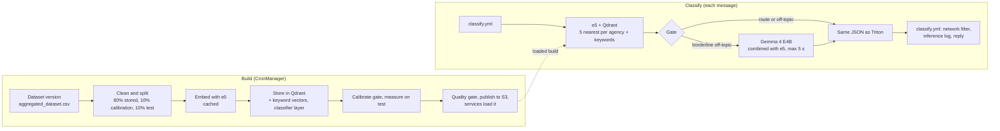

# Embedding classifier: architecture

The embedding classifier replaces the GPU-trained agency classifier (XLM-RoBERTa,
EstBERT or DistilBERT served by Triton) with one that runs on CPU and needs no
training. The multilingual e5 model turns every example question into a vector,
Qdrant stores them, and a message goes to the agency whose questions it is
closest to. A small language model, Gemma 4 E4B, can give a second opinion on
messages e5 is unsure of, within 5 seconds.

The chatbot doesn't change: the new service answers the same Triton v2 calls
with the same JSON, so the switch is two URLs in `constants.ini`.

See also: [DEPLOYMENT.md](DEPLOYMENT.md) (for the team that deploys it),
[OPERATIONS.md](OPERATIONS.md) (day-to-day tasks and troubleshooting) and the
package [README](../README.md) (development setup and tools).

## What changed

| | Before | After |
| --- | --- | --- |
| Model | XLM-RoBERTa base, EstBERT or DistilBERT, fine-tuned per data model | `intfloat/multilingual-e5-large-instruct`, used as is |
| Making a model | `model_trainer.py` trains on a GPU, exports ONNX, zips a Triton repository | The index builder embeds the dataset's questions and stores them in Qdrant, on CPU, in minutes |
| Serving | `triton-production-server`, `triton-test-server` (NVIDIA runtime) | `embedding-classifier-production`, `embedding-classifier-testing` (CPU), answering the same Triton v2 calls |
| What a model is | ONNX files and label mappings in S3 | A Qdrant collection plus build files in S3 under `models/indexes/{id}/` |
| Unsure or off-topic | `out_of_distribution` when the top confidence is under 0.5 (hard-coded) | A gate calibrated on held-back questions: route, clarify or off-topic |
| Quality check | Mean per-agency precision on the trainer's own 20% split | A quality report (top-1, top-3, routed share, per agency) and a quality gate that can block a bad build |
| New dataset version | Someone retrains by hand | The same for now: an admin creates a model on the new version. An automatic refresh is built but off until the team decides; when on, it adds a new version of each e5 model within 5 minutes, as a major update in the GUI does, and switches to it only if it passes and loads |
| Unsure messages | Nothing | Optional Gemma 4 E4B second opinion on CPU, 5 s limit |
| Old base models | Train through Triton | Still train through Triton, unchanged, until Triton is retired |

Unchanged: `chats/classify.yml` and its network filter, the inference logs,
feedback, the GUI and its Test Model page, the dataset pipeline and
`aggregated_dataset.csv`, `config.env`, `.env` and `docker-compose.yml`.

What callers may notice: the confidence values (a different model) and when
`out_of_distribution` appears (a calibrated cut-off instead of 0.5). The service
also returns a second output, `DECISION` (route, clarify or off-topic, and the
second opinion when one was asked), which `classify.yml` doesn't read.

## How it works

### Build

1. **Start.** Creating an e5 data model in the GUI queues a job as before;
   `train_script_starter.sh` runs `python -m builder.cli` (same arguments as the
   trainer) instead of `model_trainer.py`. The new data model is saved
   undeployed, and the model serving its environment stays until the new one
   passes and loads. The automatic refresh, when on, runs the same build for
   every new dataset version.
2. **Read** `datasets/{id}/aggregated_dataset.csv` from S3. Drop empty texts,
   duplicates within an agency, questions listed under several agencies, and
   agencies with fewer than 5 questions.
3. **Split** each agency's questions: 80% stored, 10% calibration, 10% test.
4. **Embed** with e5. Embeddings are cached by text, so a rebuild only embeds new
   questions.
5. **Store** the vectors, texts and character n-gram keyword vectors in a Qdrant
   collection. With the classifier layer on, also train a logistic regression on
   the keyword vectors and choose how much it counts on the calibration split.
6. **Calibrate** the gate on the calibration split: the off-topic cut-off keeps
   95% of real questions, the routing threshold aims at 90% accuracy, and a
   temperature turns scores into confidences.
7. **Measure** on the test split and write `quality_report.json`.
8. **Quality gate** in `enforce` mode, for GUI builds and the automatic refresh.
   A build under its limits stops here: the data model is marked
   `training_failed` with its results, no collection is kept, and nothing
   changes for users.
9. **Final build:** store the stored and test questions together (the
   calibration split stays held out and recalibrates the gate), snapshot the
   collection, publish the build files to S3, and load the model on the
   classifier for its environment. Then it takes that environment; in
   production, the model serving there becomes undeployed in the same statement
   and is unloaded a few seconds later.

### Classify

1. `chats/classify.yml` calls `{model id}-classifier-ensemble/infer` on the URL
   in `constants.ini`, as it did with Triton.
2. The service embeds the message with e5 and asks Qdrant, per agency, for the 5
   most similar stored questions; an agency's score is their mean similarity,
   blended with its best keyword match. The classifier layer, when the build has
   one, is combined in.
3. The gate decides:
   - **route**: a clear winner;
   - **clarify**: the top agencies are close;
   - **off-topic**: nothing is similar enough; `out_of_distribution` goes first,
     with confidence 1.0, so it is also the highest for a caller that picks by
     confidence.
4. **Second opinion** (when `SECOND_OPINION_MODE` is `on`): a message flagged
   off-topic by a small margin is sent to Gemma 4 E4B with e5's top 3. Gemma
   answers with one forced letter (A, B, C, or N for none). Its letter
   probabilities are combined with e5's confidences; the message is rescued as
   clarify only when Gemma is at least 90% sure of an agency. If Gemma is slower
   than 5 s, busy, or down, e5's answer goes out unchanged.
5. The response has the same JSON as Triton's: up to 5 agencies with confidences.

### The second opinion's prompt

Each build's **catalogue** (every agency with its 3 most typical questions,
about 2,400 tokens for 37 agencies) is built when a model loads and sent to the
Gemma server once. The server keeps it in a prompt cache slot (production slot
0, testing slot 1), so each message adds only about 50 tokens: the message and
the three options by number. That brought a call from 10-13 s to about 3 s on 4
CPU cores.

## Components and why

| Piece | What it does | Why this one | Tried and rejected |
| --- | --- | --- | --- |
| e5 (`multilingual-e5-large-instruct`, MIT licence) | Turns text into 1,024-number vectors | Handles Estonian, English and Russian; best of the allowed models on our data; baked into the image | bge-m3 (slightly better, but Chinese-made) · Qwen3-based models (Chinese-made) · harrier-oss-v1-270m (72.2% against 75.7%) |
| Nearest neighbours, top 5 per agency | Scores each agency by its closest stored questions | 72.9% top-1 against 62.4% for one average vector per agency | Logistic regression, random forest, boosted trees, a small network on e5 vectors: 62-73% |
| Keyword match | TF-IDF on 3-5 character pieces, weight 0.3 | Catches names and terms the vectors blur | |
| Classifier layer | Logistic regression on the keyword vectors, combined with the neighbour scores | +2.1 points top-1; more messages answered without asking to clarify; about 40 s more per build | A stacked decision model: no better than the weighted sum |
| Qdrant 1.19 | Stores vectors and texts with agency filters; snapshots | Exact search, payload filters, snapshots for backup and restore | |
| Calibrated gate | Route, clarify or off-topic | Answers only when likely right instead of always guessing | The fixed 0.5 cut-off |
| Gemma 4 E4B (Google, open weights), llama.cpp | Second opinion for borderline off-topic messages | Small enough for CPU; reads the whole sentence | Fine-tuning e5 on CPU (+1 point for 45 min per build) · Gemma overruling e5 (broke too many right answers) |
| FastAPI service | Answers Triton's `/v2/...` calls | Same request and response as Triton | |

All models are from non-Chinese makers, by requirement.

## Decisions

| Decision | Why |
| --- | --- |
| An index instead of a trained model | CPU only and a rebuild in minutes. Fine-tuning e5 on CPU was measured at only about +1 point |
| Keep Triton's API exactly | The chatbot, DSL and GUI don't change; cutover and rollback are two URLs |
| A gate that can ask to clarify | A vague message gets a clarifying question instead of a confident wrong agency |
| New behaviour behind settings | Nothing that works today changes until someone turns it on |
| GUI builds in `enforce` mode, built before they take their environment | A model built from a bad dataset version would show as trained and serve; now it shows as failed with its results. The GUI used to take the production model off before the build, so a blocked build would have left production with none; for e5 models it now waits until the new one passes and loads |
| Automatic refresh in `enforce` mode, off for now | A build under the gate's limits can't replace a working one; the live build stays until a new one passes and loads. Off until the team decides how dataset changes should reach models |
| A refresh adds a new version (a new data model row) instead of changing the serving one | The GUI shows the same history as for a dataset change made by hand; the old version stays intact, so switching back is one query; production moves to the new version in one statement, only after it is built and loaded |
| Classifier layer on | +2.1 points top-1 |
| Gemma only for borderline off-topic messages | With the layer on, asking about clarify messages broke more answers than it fixed (7 fixed, 9 broken) |
| Gemma combined with e5, rescue at 90% sure | Overruling broke too many right answers; at 50% sure it let 7 of 48 off-topic messages through, at 90% sure 4 |
| One forced letter | Text in a message can't make Gemma say anything else; the worst case is another pick among e5's top 3 |
| 5 s limit | The latency ceiling for unsure messages; a slower answer is dropped |
| Never log message text | Citizen privacy |

## Measured results

On a generated development dataset (37 agencies, 3,934 questions), averaged
over 5 random splits:

| Setup | Top-1 | Top-3 |
| --- | --- | --- |
| e5 neighbours + keyword match | 75.7% | 89.4% |
| + classifier layer | 77.8% | 89.7% |
| + layer, only questions that name their topic | 88.9% | |
| + layer, questions with no clue to the agency (43% of test questions) | 63.2% | |

Accuracy grows with examples per agency: agencies with 100-199 questions scored
89.1% on questions that name their topic, those with 200 or more 92.8%. Reaching
90% needs about 200 questions per agency that each name their topic; no model
fixes questions that carry no clue.

The old trained model was only ever tested on 3 agencies with generated
conversations: fine-tuned XLM-RoBERTa 83.3%. On that same test, e5 with no
training scores 99.1%.

Second opinion and latency: see the package README, "Second opinion results".
In the dev stack, messages Gemma isn't asked about take about 0.4-0.6 s end to
end; those it is asked about take about 2.7-4.7 s.

## Known limits

- All figures come from generated questions. A golden set of real citizen
  questions labelled by people doesn't exist yet.
- English and Russian messages are often flagged off-topic: the cut-off is
  calibrated on Estonian questions.
- Gemma answers one message at a time; under load, extra unsure messages get
  e5's answer at once.
- Gemma's 5 s limit covers only its own call; e5's 0.5-1 s comes on top.
- The second opinion lets some off-topic messages reach an agency (4 of 48 in
  tests at the defaults).
